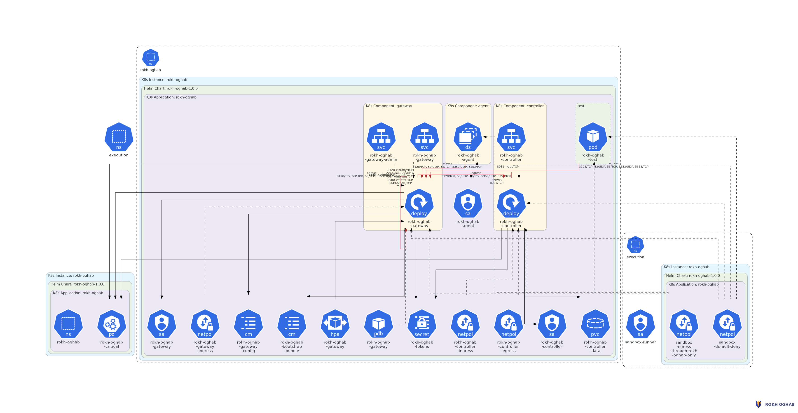

# Deploying on Kubernetes



## What gets installed

| Resource | Purpose |
| --- | --- |
| `Deployment` gateway | The data plane, autoscaled, with a disruption budget |
| `Deployment` controller | The control plane and its versioned store |
| `DaemonSet` agent | Node enforcement, holding only `NET_ADMIN` and `NET_RAW` |
| `Service` gateway | Proxy on 3128 and DNS on 53, at a fixed ClusterIP |
| `Service` gateway-admin | Metrics and admin, deliberately on a separate service |
| `NetworkPolicy` | Default-deny for sandbox namespaces, plus the gateway exception |
| `PriorityClass` | So the only egress path is not evicted before tenant workloads |
| `Secret` | Control-plane tokens, generated if you do not supply them |

## Install with Helm

### The short way

```bash
bash scripts/ro-preflight.sh
```

It reads the two cluster-specific values off the cluster itself, checks that
your CNI enforces NetworkPolicy and that you can create a DaemonSet, and prints
the install command with everything filled in. Run that command, then:

```bash
bash scripts/ro-onboard.sh --workload my-sandbox --apply
```

That mints an identity, publishes it, stores the token as a Secret in the
workload's namespace, prints the pod spec fragment to paste, and runs a pod
that proves a permitted destination works and a direct one does not.

### The long way

```bash
helm install rokh-oghab deploy/helm/rokh-oghab \
  --namespace rokh-oghab --create-namespace \
  -f deploy/helm/values-quickstart.yaml \
  --set 'sandbox.podCidrs={10.244.0.0/16}' \
  --set gateway.service.clusterIP=10.96.0.53
```

Two values matter more than the rest, and neither has a default that works on
every cluster:

- **`sandbox.podCidrs`** must match your cluster's real pod CIDR. The node agent
  confines exactly these ranges. Get it wrong and either nothing is confined or
  the wrong things are.
- **`gateway.service.clusterIP`** must be a free address inside your service
  CIDR. Sandboxes use it as their only nameserver, and a nameserver has to be an
  address rather than a name.

kube-proxy rewrites a ClusterIP to a backend pod address in `nat` prerouting,
before any filter hook sees the packet, so a rule written against the ClusterIP
alone never matches and every sandbox falls through to the default drop with no
egress at all. The agent therefore accepts the gateway address twice: once as it
arrives and once as the workload originally asked for it, read back from the
conntrack entry. `RO_MATCH_PRE_DNAT=false` turns the second form off for a
deployment that reaches the gateway by a pod address directly and wants the
smaller ruleset.

The chart refuses to install when `agent.enabled` is true and
`gateway.service.clusterIP` is empty, rather than programming nftables with an
empty address and confining nothing. `scripts/ro-preflight.sh` finds a free
address for you; the manual way is below.

Read them back from the cluster if you are unsure:

```bash
kubectl cluster-info dump | grep -m1 cluster-cidr
kubectl cluster-info dump | grep -m1 service-cluster-ip-range
```

## Install with kustomize

Edit `deploy/kubernetes/base/config.yaml` for the gateway configuration, then
create the token Secrets. `secrets.example.yaml` is a template, and it is
deliberately **not** listed in the base's `resources:` — its placeholder values
are published in this repository, so applying it would make public strings the
live control-plane tokens. Copy it, fill it in, and point the base at your copy:

```bash
cp deploy/kubernetes/base/secrets.example.yaml /path/to/private/secrets.yaml
# replace every replace-me-... value with 32 random bytes, then either
# apply it separately or add it to a kustomization that includes this base
kubectl apply -f /path/to/private/secrets.yaml
kubectl apply -k deploy/kubernetes/base
```

Applying the base without those Secrets leaves the controller and gateway pods
unable to start, rather than starting them with credentials anyone can read —
which is the direction this project fails in everywhere else.

## Placing a workload behind the gateway

Three things, all required:

```yaml
apiVersion: v1
kind: Pod
metadata:
  name: untrusted-python
  namespace: execution
  labels:
    rokhoghab.io/profile: untrusted-python
spec:
  automountServiceAccountToken: false
  # 1. the gateway is the only resolver
  dnsPolicy: None
  dnsConfig:
    nameservers: ["10.96.0.53"]
    options:
      - name: ndots
        value: "2"
  securityContext:
    runAsNonRoot: true
    runAsUser: 1000
    seccompProfile:
      type: RuntimeDefault
  containers:
    - name: sandbox
      image: python:3.12-alpine
      securityContext:
        allowPrivilegeEscalation: false
        readOnlyRootFilesystem: true
        capabilities:
          drop: ["ALL"]
      env:
        # 2. the proxy, with no bypass list
        - name: HTTP_PROXY
          value: http://rokh-oghab-gateway.rokh-oghab.svc.cluster.local:3128
        - name: HTTPS_PROXY
          value: http://rokh-oghab-gateway.rokh-oghab.svc.cluster.local:3128
        - name: NO_PROXY
          value: ""
        # 3. the identity
        - name: RO_PROXY_TOKEN
          valueFrom:
            secretKeyRef:
              name: sandbox-egress-token
              key: token
      resources:
        limits:
          cpu: "1"
          memory: 512Mi
```

`NO_PROXY: ""` is not decoration. A non-empty bypass list is the most common
way a workload accidentally routes around the gateway, and many base images set
one.

Not every library reads proxy variables. Two options:

- Leave them set and accept that libraries which ignore them simply fail, which
  is the fail-closed outcome.
- Enable transparent interception (`agent.transparent=true`), which redirects
  plain 80 and 443 into the gateway so those libraries work without knowing.

## Issuing an identity

```bash
kubectl -n rokh-oghab port-forward svc/rokh-oghab-controller 8081:8081 &

export ROCTL_ENDPOINT=http://127.0.0.1:8081
export ROCTL_TOKEN=$(kubectl -n rokh-oghab get secret rokh-oghab-tokens \
  -o jsonpath='{.data.operator}' | base64 -d)

roctl identity issue --namespace execution --profile untrusted-python
roctl publish

kubectl -n execution create secret generic sandbox-egress-token \
  --from-literal=token='ro_...'
```

## Verifying the deployment

```bash
helm test rokh-oghab -n rokh-oghab
```

Then check the boundary from inside a sandbox:

```bash
kubectl -n execution run probe --rm -it --restart=Never \
  --image=python:3.12-alpine \
  --overrides='{"spec":{"dnsPolicy":"None","dnsConfig":{"nameservers":["10.96.0.53"]}}}' \
  -- python -c "
import socket
try:
    socket.create_connection(('1.1.1.1', 443), timeout=3)
    print('BYPASS: the sandbox reached the network directly')
except OSError as e:
    print('correctly blocked:', e)
"
```

## Things worth checking on a real cluster

**Your CNI must enforce NetworkPolicy.** Flannel without a policy plugin
ignores it entirely. Calico, Cilium and most managed CNIs enforce it. If yours
does not, the node agent is doing all the work and you should keep it enabled.

**NetworkPolicy port semantics differ between CNIs.** Some evaluate the port
before service translation and some after, which is why the shipped policy
permits both 53 and 5353.

**The agent needs `NET_ADMIN`.** If your admission controller forbids it, the
DaemonSet will not start and you are relying on NetworkPolicy alone.

**Pod Security `restricted` is what stops a workload asking for host network.**
Without it a tenant can request `hostNetwork: true` and step outside the pod
CIDR the agent confines.

**An eBPF dataplane can bypass the node's `forward` hook.** The agent's rules
run in netfilter's `forward` hook, which sees a pod's egress on veth-plus-bridge
and routed dataplanes (Calico, Flannel, kindnet, the AWS VPC CNI in its usual
modes). Cilium with `bpf.hostRouting` or kube-proxy replacement can redirect
veth-to-NIC in eBPF before netfilter runs, so the `forward` hook never sees the
packet. On such a dataplane:

- set `agent.hook: both` (`RO_HOOK=both`) so the `output` hook covers
  host-routed paths as well,
- add a Cilium-native egress policy that mirrors "only the gateway" for the
  sandbox pods, and
- prove it end to end with `sudo make test-bypass` against your real node image
  and CNI before you trust the boundary.

Do not treat the `forward` hook as sufficient on an eBPF dataplane until the
bypass suite passes on it.

**Sign the policy bundle.** A gateway enforces whatever bundle it fetches, so
give the controller and gateways a shared signing key and set
`controller.requireSignature`. The chart wires this from a generated
`bundleSigning` secret; see [operations](../operations.md#signing-the-policy-bundle).
