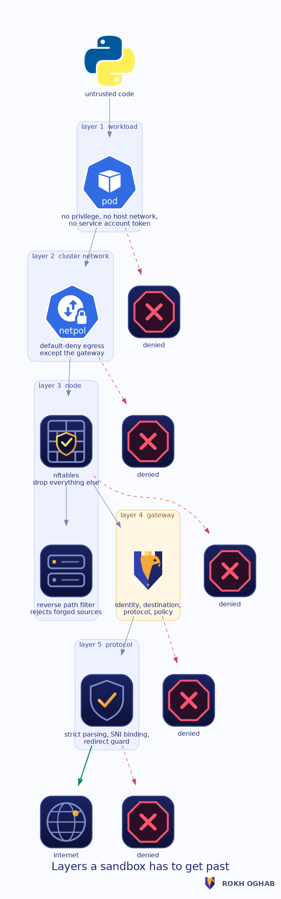

# Security model

## The invariant

> An untrusted workload cannot communicate with a destination unless the network
> path, the destination, the protocol, the identity and the active policy all
> authorise that communication.

Everything below exists to make that sentence true, and every claim in it is
backed by a test rather than by an assertion in prose.

## The layers

### Layer 1 — the workload

The sandbox pod runs with no privilege, no host network, no host process
namespace, a read-only root filesystem, every capability dropped, the default
seccomp profile and no service account token. The namespace enforces Pod
Security `restricted`, so a pod that asks for any of that is refused admission
rather than started and then contained.

This layer stops a workload from simply reprogramming the layers below it.

### Layer 2 — the cluster network

Two NetworkPolicies per sandbox namespace: one that denies all ingress and
egress, and one that re-permits exactly the gateway's proxy and DNS ports. The
gateway's admin port is not in that list, so a sandbox cannot reach the API
that could turn the emergency switch off.

This layer stops a workload that ignores `HTTP_PROXY`.

### Layer 3 — the node

`ro-agent` programs an nftables ruleset whose sandbox chain ends in a drop.
Established and related traffic is accepted, the gateway's proxy and DNS ports
are accepted, an operator-declared allow list is accepted, IPv6 is dropped
unless enabled, and everything else is dropped and counted.

Two things answer a forged source address, and which one is doing the work
depends on where you run.

The agent tries to enable reverse path filtering, so that a workload holding
`NET_RAW` cannot send packets with a forged source to slip past the
source-matched rules. That write to `/proc/sys` succeeds on a VM or bare metal,
where the Ansible role sets the sysctl and its verify playbook asserts it. It
does **not** succeed in a non-privileged DaemonSet under a standard container
runtime, where `/proc/sys` is read-only: the agent logs a warning and carries
on. On Kubernetes, treat rp_filter as something your node image or CNI provides,
not as something this chart delivers.

The control that does work in a container is interface scoping. Where the
operator names the sandbox interfaces — `sandbox.interfaces` in the chart, or
`RO_SANDBOX_IFACES` — the agent drops any packet arriving on one of them whose
source is not in the sandbox set. Set it if your workloads can hold `NET_RAW`;
the shipped `restricted` Pod Security level forbids that capability, which is
the other half of this defence.

There is a second, sharper dataplane condition, and it is not theoretical: when
sandboxes share a Linux bridge, their traffic to each other is **bridged, not
routed**, so it reaches netfilter only if `br_netfilter` is loaded and
`net.bridge.bridge-nf-call-iptables` is `1`. With that sysctl at `0` the
node rules still drop everything routed off the node, which makes the boundary
look intact, while a sandbox reaches every address on its own bridge — other
sandboxes and the gateway's admin port included — without passing the gateway
at all. The agent therefore reads the sysctl on every apply, sets it to `1`
where it can, and warns loudly where it cannot; `RO_ENFORCE_BRIDGE_NF=false`
turns the write off and leaves only the warning. If the module is not loaded at
all the agent cannot set anything, so load `br_netfilter` on the node.

This layer holds even if a NetworkPolicy is deleted or the CNI misbehaves,
with one further dataplane caveat. The rules live in the netfilter `forward` hook, so
they see a packet only if the packet traverses netfilter on its way off the
node. That is true for veth-plus-bridge and routed dataplanes — Calico,
Flannel, kindnet, the AWS VPC CNI in its usual modes. It is **not**
automatically true for an eBPF dataplane that redirects a pod's traffic in the
TC or XDP layer before netfilter runs: Cilium with `bpf.hostRouting` or
kube-proxy replacement can steer veth-to-NIC in eBPF and skip the `forward`
hook. On such a dataplane, run the agent with `RO_HOOK=both` so the `output`
hook covers host-routed paths as well, add a Cilium-native egress policy that
mirrors the boundary, and prove it with `sudo make test-bypass` on the actual
node image before you trust it. Do not assume the `forward` hook is enough
until the bypass suite confirms it on your CNI.

### Layer 4 — the gateway

Identity, destination, protocol and policy. Described in detail below.

### Layer 5 — the protocol

Strict parsing, SNI bound to the tunnel authority, TLS version floors, redirect
evaluation, response framing validation. Described in detail below.

### Layer 6 — the control plane

A gateway that fetched a forged policy would enforce it faithfully, so the
bundle it adopts has to be provably the one the controller published. The
controller signs every bundle it serves with HMAC-SHA256 over the exact bytes
on the wire, under a key it shares only with its gateways, and sends the digest
in the `X-RO-Bundle-Signature` header. A gateway configured with that key
recomputes the HMAC over the bytes it received and adopts the bundle only if
the two match, comparing in constant time. Set `controller.requireSignature`
so a gateway refuses to adopt any bundle that is unsigned or wrongly signed —
including one injected by whoever sits on the network path — rather than
trusting the transport.

Signing gives integrity independent of transport, which is what matters: a
network attacker between controller and gateway cannot forge a bundle without
the key even over cleartext HTTP. Point `controller.url` at an `https://`
endpoint to add confidentiality on top; the gateway verifies the peer
certificate against the trust store the node provides and fails closed if the
handshake does not verify.

This layer stops a tampered or impersonated control plane from widening the
boundary.

## What each attack runs into

### Reaching cloud metadata

The single most valuable target in most environments. Rokh Oghab refuses it
several times over:

- the address guard blocks `169.254.0.0/16`, `100.100.100.200`, `192.0.0.192`
  and `fd00:ec2::254` by default, before policy is consulted
- the host is canonicalised first, so `2852039166`, `0xa9fea9fe`,
  `0251.0376.0251.0376`, `169.254.43518` and `169.16689662` are all recognised
  as the same address
- IPv6 encodings are unwrapped and the embedded IPv4 is checked, covering
  v4-mapped, v4-compatible, v4-translated, 6to4, NAT64, ISATAP and Teredo
- obfuscated literals are refused outright by default even when they decode to
  a public address, because legitimate clients do not write addresses that way
- DNS answers that point at internal space are dropped before they are returned
- a redirect whose `Location` resolves to internal space is refused

### DNS rebinding

The client never chooses the address. The gateway resolves the name, filters
the answers through the address guard, and connects to what it resolved. A
second answer arriving later has nothing to rebind because the connection was
already made to a pinned address.

The gateway is also the sandbox's only resolver, so the sandbox cannot ask a
resolver of its own choosing. Only `A` and `AAAA` records are served, which
removes `TXT` and `NULL` records as an exfiltration channel.

### Request smuggling

The parser refuses, rather than interprets, anything ambiguous:

| Vector | Result |
| --- | --- |
| `Content-Length` with `Transfer-Encoding` | rejected |
| Two `Content-Length` headers that disagree | rejected |
| `Content-Length: 5, 6` | rejected |
| `Transfer-Encoding: identity` or `chunked, identity` | rejected |
| Two `Transfer-Encoding: chunked` headers | rejected |
| A bare LF ending a line | rejected |
| An obsolete folded header | rejected |
| Whitespace before a header's colon | rejected |
| Two spaces in the request line | rejected |
| A lowercase method or an unknown method | rejected |
| `HTTP/0.9` or `HTTP/2.0` on the proxy port | rejected |
| Two `Host` headers, or none on HTTP/1.1 | rejected |
| A `Host` header that disagrees with the request target | rejected |
| Userinfo in the authority | rejected |

Chunked bodies are re-encoded canonically on the way out, so chunk extensions
cannot be smuggled downstream, and trailers are dropped.

### Tunnel abuse

A `CONNECT` tunnel is not a blank cheque. Before a single byte is forwarded the
gateway reads the TLS ClientHello and requires the SNI to match the authority
in the `CONNECT` line. A tunnel opened to a permitted host cannot be turned
into a session with a denied host.

The negotiated version must meet the configured floor. Plaintext inside a
tunnel to a configured TLS port is refused, so a tunnel cannot be repurposed as
a generic TCP relay on 443.

### Path confusion

When a rule constrains paths, the path is matched in normalised form and the
request must arrive already normalised. `/public/../private` never reaches an
origin, and neither do `%2e%2e`, `%2f`, `%5c` or `%00`.

### Identity forgery

Identity headers are only honoured from source ranges an operator has declared
trusted. `X-Forwarded-For` has no effect. Credentials in the request target are
refused. A token that fails to validate does not fall back to source-based
identity — it is refused, so a bad token cannot downgrade into a weaker but
still usable identity.

Tokens are stored as SHA-256 digests and compared by digest lookup, so the
store never holds a usable credential and comparison does not leak length or
content through timing.

### Information leaks

Credentials never reach an upstream: `Proxy-Authorization` and the other
hop-by-hop headers are stripped. Deny responses never echo the credential.
Metrics carry bounded labels — profile, namespace, reason, protocol — and never
destinations, so the metric endpoint cannot be used to enumerate where a tenant
goes. The audit trail records decisions, not credentials.

## Where the design chooses to fail closed

| Situation | Choice |
| --- | --- |
| No identity | deny |
| A token that does not validate | deny, without falling back |
| No policy bundle loaded | deny |
| A bundle whose signature does not verify, when a signing key is set | deny, without adopting it |
| An unsigned bundle, when `controller.requireSignature` is set | deny, without adopting it |
| An `https` control-plane peer whose certificate does not verify | deny the fetch, keep the last good bundle until it goes stale |
| The bundle is older than its staleness limit and a controller is configured | deny |
| A destination that cannot be classified | deny |
| A response the gateway cannot frame unambiguously | deny |
| A DNS answer entirely inside blocked space | deny |
| No admin token configured on the gateway | every privileged admin request is refused |
| No principal configured on the controller | every authenticated endpoint is refused |

The one deliberate exception is that health, readiness and metrics remain
available without a token, so an operator can see that a gateway is failing
closed rather than guessing. Those endpoints still respect the source
allow list.

## What is enforced by tests

| Claim | Suite |
| --- | --- |
| Every documented metadata encoding is refused | `make test-security` |
| DNS answers pointing inward are dropped | `make test-e2e`, `make test-security` |
| Smuggling vectors are rejected | `make test-unit`, `make test-security` |
| A tunnel cannot be repurposed by SNI | `make test-security` |
| Keep-alive re-evaluates every request | `make test-e2e` |
| A revoked token stops working after a publish | `make test-control` |
| The controller signs the served bundle byte-for-byte | `make test-control` |
| A gateway adopts only a bundle whose signature verifies | `make test-control` |
| HMAC-SHA256 matches the published standard vectors | `make test-unit` |
| A gateway that loses its controller keeps enforcing | `make test-control` |
| A sandbox cannot reach anything but the gateway | `sudo make test-bypass` |
| Forged source addresses never arrive | `sudo make test-bypass` |
| Stopping the gateway removes network access | `sudo make test-enforcement` |
| Nothing shipped weakens the boundary | `make audit-defaults` |

## What this model does not cover

Read [the threat model](threat-model.md) for the boundaries of the claim,
including the parts of the problem Rokh Oghab deliberately does not solve.
